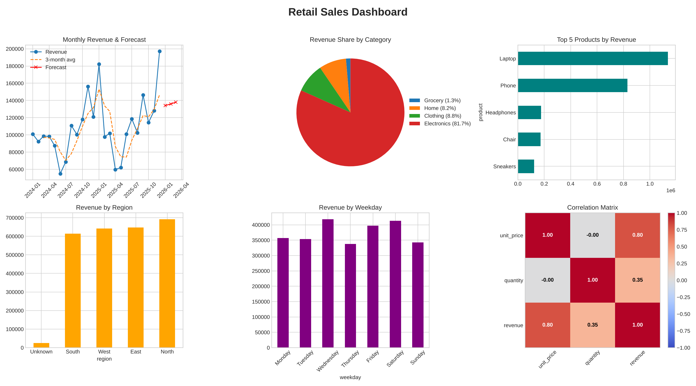

# 📊 Retail Sales Analytics

An end-to-end data analysis project built with **NumPy**, **Pandas** and **Matplotlib**.
It generates a realistic sales dataset, cleans it, extracts business insights, forecasts future revenue and renders a 6-panel dashboard.



## ✨ What it does

| Step | Description | Library |
|------|-------------|---------|
| 1. Data generation | Creates 5,000 synthetic orders (2024–2025) with trend, seasonality, noise, missing values and duplicates | NumPy |
| 2. Cleaning | Removes duplicates, fills missing regions and prices (median per product), adds `revenue`, `month`, `weekday` | Pandas |
| 3. Analysis | KPIs, monthly revenue, 3-month moving average, top products, category/region/weekday breakdown, correlations | Pandas, NumPy |
| 4. Forecast | Fits a linear regression (`np.polyfit`) on monthly revenue and predicts the next 3 months | NumPy |
| 5. Visualization | Saves a dashboard with line, pie, bar and heatmap charts | Matplotlib |

## 🚀 Getting started

```bash
git clone https://github.com/<your-username>/retail-sales-analytics.git
cd retail-sales-analytics
python -m venv .venv
source .venv/bin/activate        # Windows: .venv\Scripts\activate
pip install -r requirements.txt
python main.py
```

Outputs are written to the `outputs/` folder:

- `dashboard.png` – the full dashboard
- `clean_sales.csv` – the cleaned dataset

## 📈 Sample console output

```
Raw rows: 5030 | missing values: 65
Clean rows: 5000

=== KPIs ===
Total revenue   : $2,619,490
Orders          : 5,000
Avg order value : $523.90
```

## 🔍 Key insights from the data

- **Electronics** drive ~82% of total revenue, led by laptops and phones.
- Revenue shows a clear **seasonal peak at the end of the year** on top of a gradual growth trend.
- `unit_price` correlates strongly with revenue (0.80), `quantity` much less (0.35).

## 🗂 Project structure

```
retail-sales-analytics/
├── main.py            # full pipeline
├── requirements.txt
├── outputs/
│   └── dashboard.png
└── README.md
```

## 🛠 Ideas for extension

- Replace the synthetic data with a real dataset (e.g. from Kaggle)
- Try better forecasting models (Prophet, ARIMA, scikit-learn)
- Build an interactive version with Streamlit or Plotly

## 📄 License

MIT
